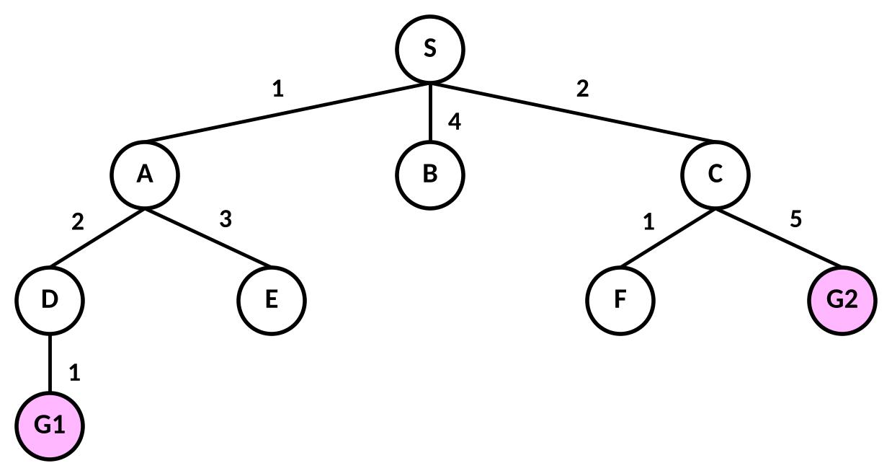
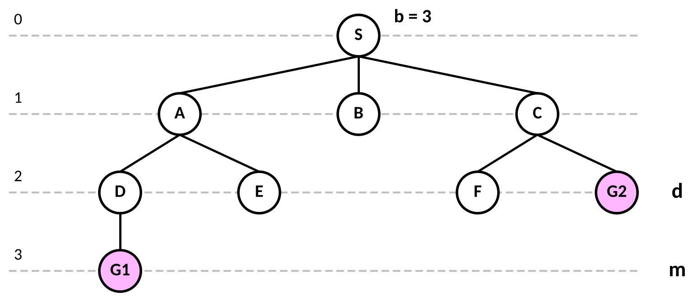
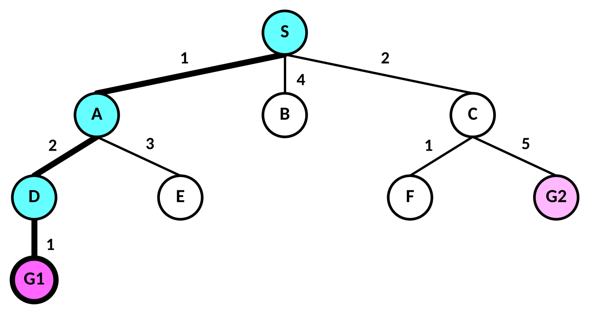
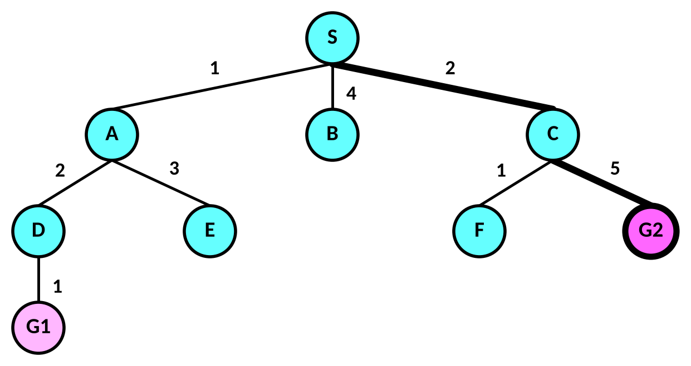
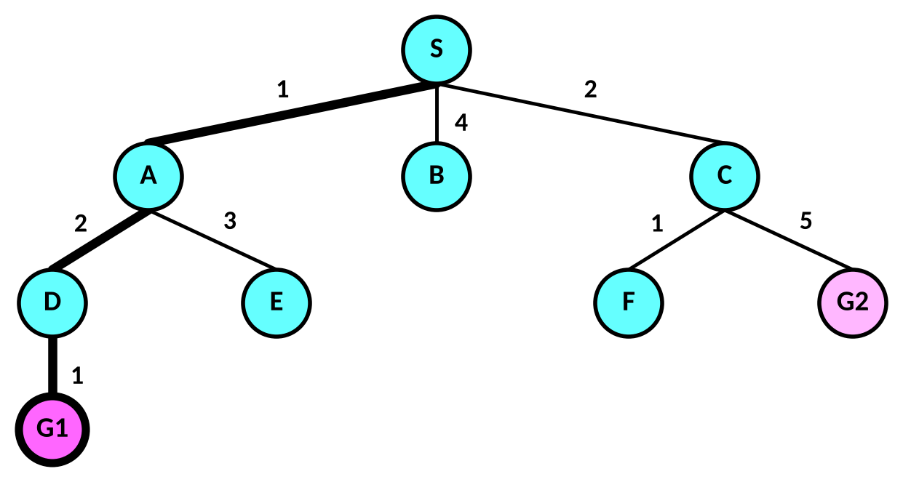
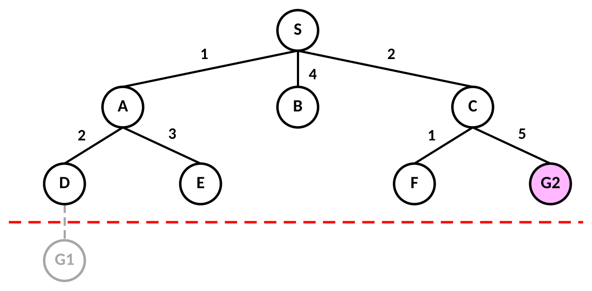
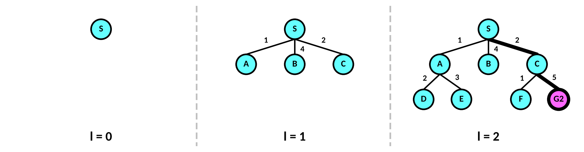

# Упражнение 1: Неинформирано търсене

## Пространство на състоянията (State space)
- **Състояние (State)** - представяне на задачата в процеса на нейното решаване
  - **Начално състояние** - означаваме го с $S$
  - **Междинно състояние** - всяка главна буква, различна от $S$ и $G$
  - **Целево състояние** - означаваме го с $G$, а ако са повече - $G_1, G_2, \dots$
- **Функция на наследниците (Successor function)** - начинът, по който от едно състояние получаваме друго ( *оператор* )
- **Цена на пътя (Path cost)** - сумира се по пътя, напр. сума от разстояния или брой извършени действия
- **Пространство на състоянията (State space)** - всички състояния, които можем да получим от началното

**Решението** е последователност от действия, която води от началното до целево състояние.

### Дърво на търсене (Search tree)
Пространството на състоянията се представя като граф или дърво: всяко **състояние е връх**, а всеки **преход е ребро**. Когато е дърво, го наричаме **дърво на търсене**:
- Коренът е началното състояние
- Листата са крайните и целевите състояния

#### Пример: (*дървото, което използваме във всички примери*)

> Числата по ребрата са цените на преходите. $G_1$ и $G_2$ са целеви състояния.

 

## Как оценяваме стратегиите за търсене?
- **Пълнота (Completeness)** - винаги ли намира решение, ако такова съществува?
- **Оптималност (Optimality)** - винаги ли намира решението с **най-малка цена**?
- **Времева сложност (Time complexity)** - брой генерирани върхове (интересува ни най-лошият случай)
- **Пространствена сложност (Space complexity)** - максимален брой върхове, които държим в паметта

Сложността се измерва чрез:
- $b$ - максимален брой наследници на един връх ( *branching factor* )
- $d$ - дълбочина на най-плиткото решение
- $m$ - максимална дълбочина на пространството (може да е $\infty$)

#### Пример:

> - $b = 3$ (S има 3 наследника)
> - $d = 2$ (най-плиткото решение е $G_2$)
> - $m = 3$ (най-дълбокият връх е $G_1$).

 

## Глобално и локално търсене
- **Глобално търсене (Global search)** - търси в цялото пространство на състоянията. Ако е нужно, ще обходи всички състояния.
- **Локално търсене (Local search)** - гледа само около текущото състояние. Ако решението е извън тази област, няма да го намери.

#### ❕**ЗАБЕЛЕЖКА**❕
> Локалното търсене **не** се използва за намиране на път от A до B. Използваме го, когато ни интересува само самото решение, а не пътят до него - напр. генетичните алгоритми и hill climbing ([Упражнение 2](../Sem%2002/README.md)).

 

## Неинформирано (сляпо) търсене (Uninformed search)
Неинформираните стратегии използват **само информацията от условието** на задачата. Нямат никаква представа къде може да е целта.

### Общ алгоритъм
Всички неинформирани стратегии са **един и същ алгоритъм** - разликата е само в това **кой връх вадим следващ**. Върховете, които чакат да бъдат разгледани, наричаме **фронт** ( *frontier* ).

> #### Алгоритъм:
> 1) Слагаме $S$ във фронта
> 2) Вадим връх от фронта (кой - зависи от стратегията)
> 3) Ако върхът е целеви - край, намерихме решение
> 4) Иначе добавяме наследниците му във фронта и се връщаме на стъпка 2)

| Стратегия | Фронт | Кой връх вадим |
| :--- | :--- | :--- |
| DFS | Стек | Последно добавения |
| BFS | Опашка | Първо добавения |
| UCS | Приоритетна опашка | Този с най-малка цена на пътя до момента |

#### ❕**ВАЖНО**❕
> Проверката дали върхът е целеви става, когато го **вадим** от фронта, а не когато го добавяме. Това е важно за UCS - иначе можем да спрем на по-скъпо решение.

 

## Търсене в дълбочина (Depth-First Search, DFS)
Слизаме **колкото се може по-надълбоко** по един клон и чак когато стигнем задънена улица, се връщаме назад.

#### Пример:

| Стъпка | Вадим | Стек след стъпката (върхът е вдясно) |
| :---: | :---: | :--- |
| 1 | S | C, B, A |
| 2 | A | C, B, E, D |
| 3 | D | C, B, E, $G_1$ |
| 4 | $G_1$ | цел! |

> Децата се добавят в обратен ред, за да вадим първо най-лявото. DFS намира $S \rightarrow A \rightarrow D \rightarrow G_1$ с цена $4$ - тук имаме късмет, но в общия случай DFS не е оптимален.

| Пълен? | Оптимален? | Време | Памет |
| :---: | :---: | :---: | :---: |
| Не | Не | $O(b^m)$ | $O(bm)$ |

#### ❕**ЗАБЕЛЕЖКА**❕
> **Защо не е пълен?** Ако някой клон е безкраен (напр. състоянията са числа и винаги можем да умножим по 2), DFS може да слиза по него завинаги. В крайни пространства DFS е пълен.
>
> **Защо памет $O(bm)$?** Пазим само текущия път (най-много $m$ върха) и за всеки връх от него - неговите наследници (най-много $b$).

 

## Търсене в ширина (Breadth-First Search, BFS)
Обхождаме дървото **ниво по ниво** - първо всички върхове на дълбочина 1, после на дълбочина 2 и т.н.

#### Пример:

| Стъпка | Вадим | Опашка след стъпката (вадим отляво) |
| :---: | :---: | :--- |
| 1 | S | A, B, C |
| 2 | A | B, C, D, E |
| 3 | B | C, D, E |
| 4 | C | D, E, F, $G_2$ |
| 5 | D | E, F, $G_2$, $G_1$ |
| 6 | E | F, $G_2$, $G_1$ |
| 7 | F | $G_2$, $G_1$ |
| 8 | $G_2$ | цел! |

> BFS намира $S \rightarrow C \rightarrow G_2$ - **най-плиткото** решение, но с цена $7$. Решението през $G_1$ е по-дълбоко, но струва само $4$.

| Пълен? | Оптимален? | Време | Памет |
| :---: | :---: | :---: | :---: |
| Да (ако $b$ е крайно) | Да*, ако всяка стъпка струва 1 | $O(b^{d+1})$ | $O(b^{d+1})$ |

#### ❕**ЗАБЕЛЕЖКА**❕
> **Откъде идва $O(b^{d+1})$?** Ако целта е последният връх на ниво $d$, обхождаме всички нива до $d$ и генерираме децата на всеки връх от ниво $d$ (без целта):
>
> $$b^0 + b^1 + \dots + b^d + b(b^d - 1) = O(b^{d+1})$$

 

## Търсене с равномерна цена (Uniform-Cost Search, UCS)
Винаги вадим върха с **най-малка цена на пътя** от началото до него. Фронтът е **приоритетна опашка**, подредена по тази цена.

#### Пример:

| Стъпка | Вадим (цена) | Приоритетна опашка след стъпката |
| :---: | :---: | :--- |
| 1 | S (0) | A (1), B (4), C (2) |
| 2 | A (1) | B (4), C (2), D (3), E (4) |
| 3 | C (2) | B (4), D (3), E (4), F (3), $G_2$ (7) |
| 4 | D (3) | B (4), E (4), F (3), $G_2$ (7), $G_1$ (4) |
| 5 | F (3) | B (4), E (4), $G_2$ (7), $G_1$ (4) |
| 6 | B (4) | E (4), $G_2$ (7), $G_1$ (4) |
| 7 | E (4) | $G_2$ (7), $G_1$ (4) |
| 8 | $G_1$ (4) | цел! |

> $G_2$ влиза в опашката още на стъпка 3, но с цена $7$. Тъй като проверяваме за цел при **изваждане**, UCS първо изважда по-евтините върхове и намира $S \rightarrow A \rightarrow D \rightarrow G_1$ с цена $4$ - оптималното решение. При равни цени вадим първо добавения по-рано.

Нека $C^*$ е цената на оптималното решение, а $\varepsilon$ - най-малката цена на ребро.

| Пълен? | Оптимален? | Време | Памет |
| :---: | :---: | :---: | :---: |
| Да | Да, ако цените са неотрицателни | $O(b^{\lceil C^*/\varepsilon \rceil})$ | $O(b^{\lceil C^*/\varepsilon \rceil})$ |

#### ❕**ЗАБЕЛЕЖКА**❕
> UCS е **алгоритъмът на Дейкстра**, с една разлика: спира веднага щом намери целево състояние, вместо да търси най-късия път до всички върхове.

 

## Търсене с ограничена дълбочина (Depth-Limited Search, DLS)
DFS с ограничение $l$ - върховете на дълбочина $l$ се третират така, сякаш **нямат наследници**. Когато клонът стигне дълбочина $l$, DLS спира да копае там и се връща назад.

#### Пример с $l = 2$:

> D, E, F и $G_2$ се третират като листа - $G_1$ (на дълбочина 3) никога не се генерира, въпреки че съществува.

| Пълен? | Оптимален? | Време | Памет |
| :---: | :---: | :---: | :---: |
| Да, ако $l \ge d$ | Не | $O(b^l)$ | $O(bl)$ |

 

## Итеративно задълбочаване (Iterative Deepening Search, IDS)
Пускаме DLS с $l = 0$, после с $l = 1$, после с $l = 2$, ... - **всеки път отначало от корена** - докато намерим цел.

#### Пример:

> При $l = 0$ и $l = 1$ няма цел. При $l = 2$ намираме $G_2$ - същото решение като BFS, защото и IDS обхожда дървото **ниво по ниво**.

| Пълен? | Оптимален? | Време | Памет |
| :---: | :---: | :---: | :---: |
| Да | Да*, ако всяка стъпка струва 1 | $O(b^d)$ | $O(bd)$ |

#### ❕**ВАЖНО**❕
> IDS съчетава най-доброто от двете: **малката памет на DFS** (отдолу е DFS) и **пълнотата и оптималността на BFS** (първата итерация, която намери цел, я намира на най-малката възможна дълбочина).

### IDS или BFS?
На пръв поглед IDS губи време, защото преобхожда горните нива отново и отново. Нека $b = 10$, $d = 5$ и целта е най-десният връх:

$$N_{IDS} = 6 + 10 \cdot 5 + 100 \cdot 4 + 1000 \cdot 3 + 10^4 \cdot 2 + 10^5 = 123\ 456$$

$$N_{BFS} = 1 + 10 + 100 + 1000 + 10^4 + 10^5 + 999\ 990 = 1\ 111\ 101$$

> IDS генерира около **9 пъти по-малко** върхове, защото не генерира децата на върховете от последното ниво $d$. А повторената работа е малка - почти всички върхове са на последното ниво.

 

## Обобщение
| Алгоритъм | Пълен? | Оптимален? | Време | Памет | Фронт |
| :--- | :---: | :---: | :---: | :---: | :--- |
| DFS | Не | Не | $O(b^m)$ | $O(bm)$ | Стек |
| BFS | Да* | Да* | $O(b^{d+1})$ | $O(b^{d+1})$ | Опашка |
| UCS | Да | Да | $O(b^{\lceil C^*/\varepsilon \rceil})$ | $O(b^{\lceil C^*/\varepsilon \rceil})$ | Приоритетна опашка |
| DLS | Да*, ако $l \ge d$ | Не | $O(b^l)$ | $O(bl)$ | Стек |
| IDS | Да | Да* | $O(b^d)$ | $O(bd)$ | Стек |

> \* BFS е пълен, ако $b$ е крайно. BFS и IDS са оптимални, ако всяка стъпка струва 1.
