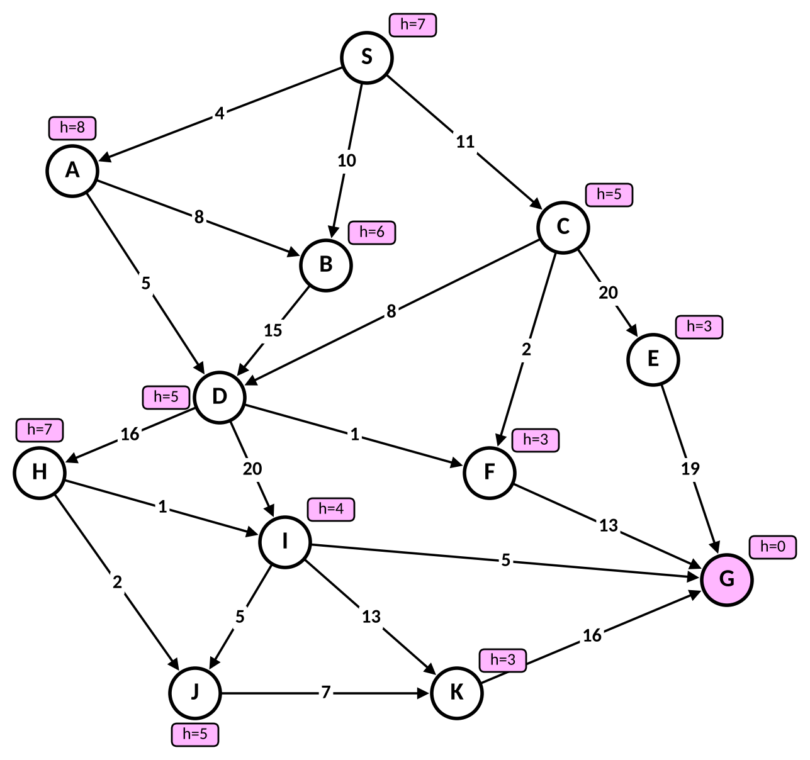
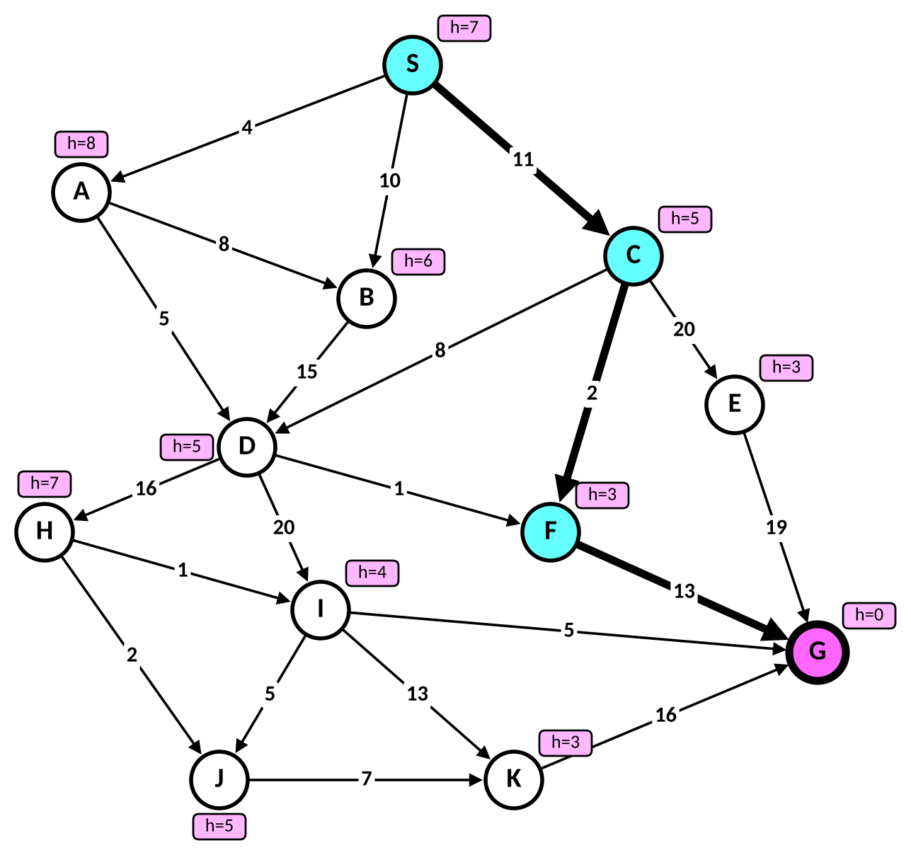
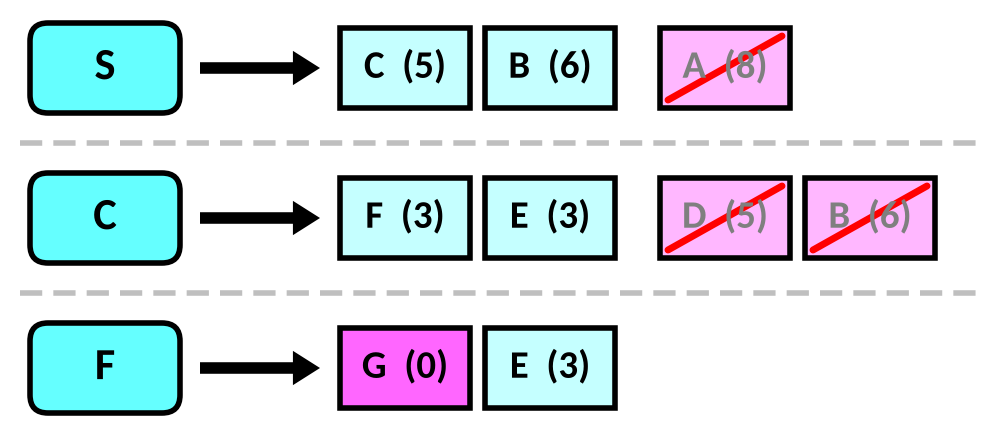
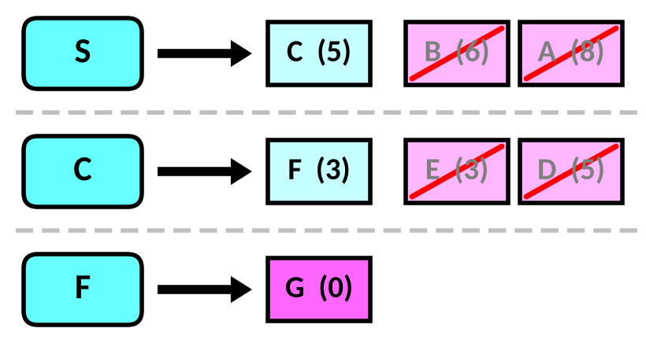
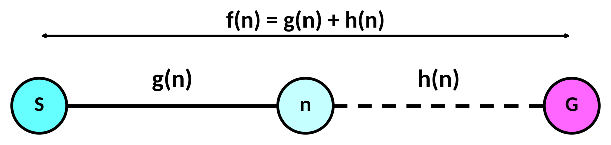
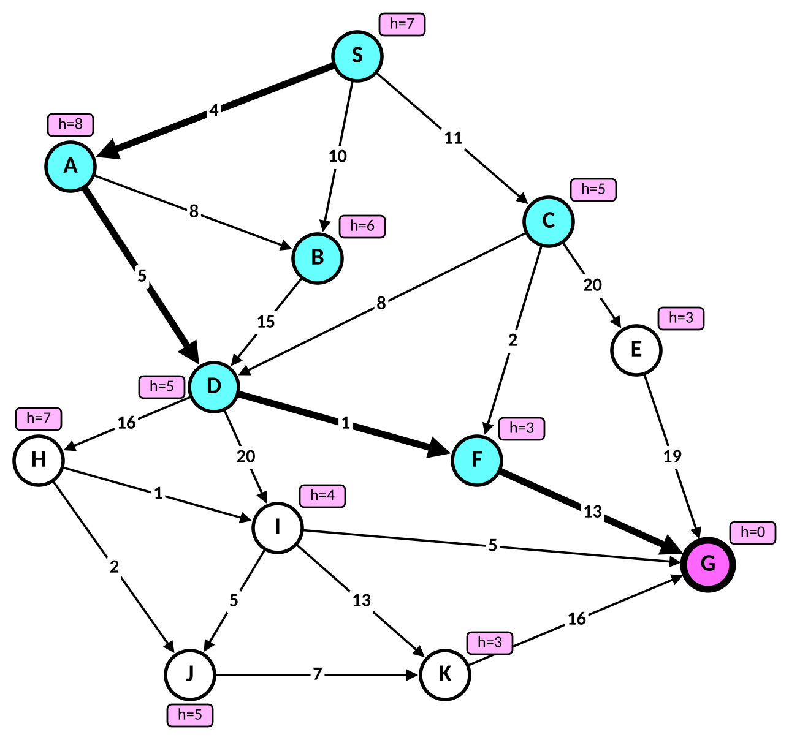
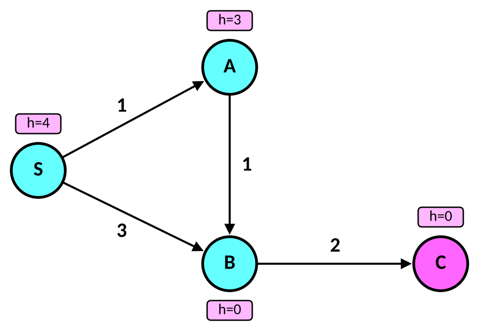
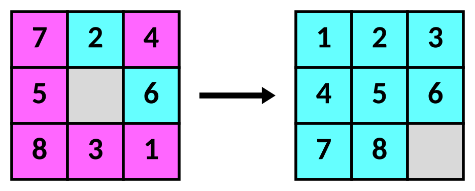

# Упражнение 2: Информирано търсене и локално търсене

## Неинформирано vs. информирано търсене
- **Неинформирано търсене (Uninformed search)** - използва само информацията от условието на задачата. Не знае накъде е целта. ([Упражнение 1](../Sem%2001/README.md))
- **Информирано търсене (Informed search)** - има допълнителна информация **колко близо е дадено състояние до целта**. Тази информация идва от функция, която наричаме **евристика**.

## Евристика (Heuristic)
**Евристиката** $h(n)$ е функция, която **оценява** колко струва пътят от състоянието $n$ до целево състояние. Тя е само предположение - може да греши, но ни помага да предпочитаме по-обещаващите състояния и да разглеждаме по-малко върхове.

- $h(n) \ge 0$ за всяко състояние $n$
- $h(G) = 0$ за всяко целево състояние $G$

#### Пример: (*графът, който използваме във всички примери*)

> Числата по ребрата са цените на преходите, а в розовите кутийки е евристиката $h(n)$ за всеки връх. Търсим път от $S$ до $G$. Най-евтиният път е $S \rightarrow A \rightarrow D \rightarrow F \rightarrow G$ с цена $4 + 5 + 1 + 13 = 23$.

 

## Алчно търсене (Greedy Best-first search)
Работи **точно като UCS**, но приоритетната опашка е подредена по евристиката $h(n)$, а не по цената на пътя. Винаги вадим върха, който **изглежда най-близо до целта**.

#### Пример:

| Стъпка | Вадим ($h$) | Приоритетна опашка след стъпката |
| :---: | :---: | :--- |
| 1 | S (7) | A (8), B (6), C (5) |
| 2 | C (5) | A (8), B (6), D (5), F (3), E (3) |
| 3 | F (3) | A (8), B (6), D (5), E (3), G (0) |
| 4 | G (0) | цел! |

> Алчното търсене намира $S \rightarrow C \rightarrow F \rightarrow G$ с цена $11 + 2 + 13 = 26$, въпреки че има път с цена $23$. Причината е, че гледа **само напред** ($h$) и изобщо не се интересува колко вече е платило по пътя.

| Пълен? | Оптимален? | Време | Памет |
| :---: | :---: | :---: | :---: |
| Не* | Не | $O(b^m)$ | $O(b^m)$ |

#### ❕**ЗАБЕЛЕЖКА**❕
> \* Може да се завърти в цикъл. Пълен е в крайни пространства, ако не посещаваме едно състояние повторно.
>
> Колко добре работи зависи изцяло от евристиката - с добра $h$ отива право към целта, а с лоша се държи като DFS, който обикаля в грешната посока.

 

## Търсене в лъч (Beam Search)
Алчно търсене с **ограничена опашка** - пазим само $l$-те най-добри върха (по $h$). Всички останали **махаме завинаги** и никога не се връщаме към тях. Числото $l$ наричаме **ширина на лъча** ( *beam width* ).

#### Пример с $l = 2$:

> Вляво е върхът, който вадим, а вдясно - опашката след стъпката (в скоби е $h$). Задрасканите върхове не се побират в лъча и се премахват:
> - от $S$ запазваме $C$ и $B$, а $A$ премахваме
> - от $C$ запазваме $F$ и $E$, а $D$ и $B$ премахваме
> - от $F$ добавяме $G$ и го намираме с цена $26$
>
> $A$ е премахнат още на първата стъпка, затова оптималният път $S \rightarrow A \rightarrow D \rightarrow F \rightarrow G$ вече **не може** да бъде намерен.

| Пълен? | Оптимален? | Време | Памет |
| :---: | :---: | :---: | :---: |
| Не | Не | $O(bml)$ | $O(bl)$ |

#### ❕**ЗАБЕЛЕЖКА**❕
> **Защо време $O(bml)$?** На всяко ниво разширяваме $l$ върха, всеки има до $b$ наследника, и правим това за най-много $m$ нива.
>
> **Защо не е пълен?** Това е **локално** търсене - целта може да бъде изхвърлена от лъча.

 

## Изкачване на хълм (Hill Climbing)
Това е търсене в лъч с $l = 1$ - след всяка стъпка оставяме **само най-добрия наследник**. Няма връщане назад.

#### Пример:

> От $S$ отиваме в $C$, от $C$ → в $F$, от $F$ → в $G$. Пак получаваме пътя с цена $26$.

| Пълен? | Оптимален? | Време | Памет |
| :---: | :---: | :---: | :---: |
| Не | Не | $O(bm)$ | $O(b)$ |

> Сложностите са тези на търсенето в лъч с $l = 1$.

### Локален максимум
Нека гледаме на hill climbing като на **оптимизация** - искаме да намерим най-високата точка. Алгоритъмът се движи към по-добрия съсед, докато **няма по-добър съсед**. Проблемът е, че така често спира на **локален максимум**. Там и наляво, и надясно е по-ниско, затова алгоритъмът спира - въпреки че **глобалният максимум** е по-високо.

Как да излезем от локален максимум?
- **Случайни рестарти (Random restarts)** - пускаме Hill Climbing отново от случайна начална точка и пазим най-добрия резултат. При достатъчно рестарти рано или късно ще започнем по склона на глобалния максимум.
- **Симулирано закаляване (Simulated annealing)** - понякога приемаме и **по-лош** ход с вероятност

$$P = e^{-\Delta / T}$$

> $\Delta$ е колко по-лош е ходът, а $T$ е "температурата":
> - висока $T$ и малко $\Delta$ - почти винаги приемаме лошия ход (изследваме)
> - ниска $T$ и голямо $\Delta$ - почти никога не го приемаме (успокояваме се)
>
> С времето $T$ намалява, лошите ходове стават все по-редки и накрая алгоритъмът се държи като обикновен Hill Climbing.

 

## A* търсене (A* search)
**Идея:** да не разширяваме пътища, които вече са скъпи. Затова комбинираме UCS и алчното търсене - гледаме **и назад, и напред**.

$$f(n) = g(n) + h(n)$$

- $g(n)$ - цената на пътя от началото до $n$ (това, което вече сме платили, както при UCS)
- $h(n)$ - оценката от $n$ до целта (както при алчното търсене)
- $f(n)$ - оценка на цената на **целия път** от началото до целта, минаващ през $n$

Фронтът е **приоритетна опашка, подредена по $f(n)$**. Проверката за цел отново става, когато **вадим** върха.

#### Пример:

| Стъпка | Вадим | $g$ | $h$ | $f = g + h$ |
| :---: | :---: | :---: | :---: | :---: |
| 1 | S | 0 | 7 | 7 |
| 2 | A | 4 | 8 | 12 |
| 3 | D | 9 | 5 | 14 |
| 4 | F (през D) | 10 | 3 | 13 |
| 5 | B | 10 | 6 | 16 |
| 6 | C | 11 | 5 | 16 |
| 7 | F (през C) | 13 | 3 | 16 |
| 8 | B (през A) | 12 | 6 | 18 |
| 9 | G | 23 | 0 | 23 - цел! |

> A* намира $S \rightarrow A \rightarrow D \rightarrow F \rightarrow G$ с цена $23$ - оптималния път.
>
> $G$ влиза в опашката още на стъпка 4 с $f = 23$, но не го вадим веднага - първо вадим всички върхове с по-малко $f$ (тези с $f = 16$ и $f = 18$). Едва когато $G$ е най-евтиният във фронта, сме сигурни, че няма по-евтин път до него.

| Пълен? | Оптимален? | Време | Памет |
| :---: | :---: | :---: | :---: |
| Да* | Да* | $O(b^d)$ | $O(b^d)$ |

> \* Пълен, ако цените са положителни и всеки връх има краен брой наследници. Оптимален, ако евристиката е **допустима** (при дърво) или **консистентна** (при граф) - вижте по-долу.

 

## Допустима и консистентна евристика
### Допустима евристика (Admissible heuristic)
Евристиката е **допустима**, ако **никога не надценява** истинската цена до целта:

$$h(n) \le h^*(n)$$

където $h^*(n)$ е истинската (най-малката) цена от $n$ до целта.

### Консистентна евристика (Consistent heuristic)
Евристиката е **консистентна**, ако за всеки връх $n$ и всеки негов наследник $n'$:

$$h(n) \le c(n, n') + h(n')$$

където $c(n, n')$ е цената на прехода от $n$ до $n'$. Казано по друг начин - оценката не може да падне с повече от цената на реброто, по което сме минали.

#### ❕**ВАЖНО**❕
> - Ако $h$ е **допустима**, A* с **търсене в дърво** ( *tree search* ) е оптимален.
> - Ако $h$ е **консистентна**, A* с **търсене в граф** ( *graph search* ) е оптимален.
> - Всяка консистентна евристика е и допустима, но **не** и обратното.

> При търсене в граф пазим множество от вече разширените върхове ( *closed set* ) и не ги разширяваме повторно. При търсене в дърво нямаме такова множество.

#### Пример: евристиката от нашия граф
> Тя **не е допустима**: $h(H) = 7$, но истинската цена от $H$ е $H \rightarrow I \rightarrow G = 1 + 5 = 6$.
>
> Тя **не е и консистентна**: за реброто $D \rightarrow F$ имаме $h(D) = 5 > 1 + h(F) = 4$. Затова в таблицата по-горе $f$ на $F$ ($13$) е по-малко от $f$ на $D$ ($14$).
>
> A* все пак намери оптималния път - но с тази евристика това **не е гарантирано**.

#### Пример: допустима, но не консистентна евристика

> **Допустима е:** $h(S) = 4 \le 4$, $h(A) = 3 \le 3$, $h(B) = 0 \le 2$, $h(C) = 0 \le 0$.
>
> **Не е консистентна:** за $S \rightarrow B$ имаме $4 > 3 + 0$, а за $A \rightarrow B$ имаме $3 > 1 + 0$.

Нека пуснем A* с търсене в граф от $S$ до $C$:

| Стъпка | Вадим | $f$ | Фронт след стъпката |
| :---: | :---: | :---: | :--- |
| 1 | S | 4 | A ($f = 1 + 3 = 4$), B ($f = 3 + 0 = 3$) |
| 2 | B | 3 | A ($f = 4$), C ($f = 5 + 0 = 5$) |
| 3 | A | 4 | C ($f = 5$) - B вече е разширен, затова пропускаме $A \rightarrow B$ |
| 4 | C | 5 | цел! |

> A* връща $S \rightarrow B \rightarrow C$ с цена $5$, а оптималният път е $S \rightarrow A \rightarrow B \rightarrow C$ с цена $4$. Стигнахме до $B$ първо по по-скъпия път и после **не му дадохме шанс** да бъде подобрен.

 

## Как да изберем евристика?
#### Пример: 8-пъзел

> Вляво е текущото състояние, вдясно - целта. Всяко плъзгане на плочка в празното място струва $1$. Розовите плочки не са на мястото си.

- $h_1(n)$ - брой плочки, които **не са на мястото си** ( *Hamming distance* )
- $h_2(n)$ - сума от **разстоянията на всяка плочка до мястото ѝ** ( *Manhattan distance* )

$$h_2(n) = \sum_{\text{плочки}} |x - x'| + |y - y'|$$

| Плочка | 1 | 2 | 3 | 4 | 5 | 6 | 7 | 8 | Общо |
| :--- | :---: | :---: | :---: | :---: | :---: | :---: | :---: | :---: | :---: |
| $h_1$ | 1 | 0 | 1 | 1 | 1 | 0 | 1 | 1 | **6** |
| $h_2$ | 4 | 0 | 3 | 3 | 1 | 0 | 2 | 1 | **14** |

И двете евристики са **допустими и консистентни**.

#### ❕**ЗАБЕЛЕЖКА**❕
> **Защо Manhattan разстоянието е допустимо?** То брои ходовете, ако всяка плочка можеше да се движи **сама**, без да чака празното място и без да пречи на другите. В истинската задача ходовете са поне толкова, следователно $h_2(n) \le h^*(n)$.
>
> Това е общ начин да получим допустима евристика - решаваме **по-лесна (relaxed) задача**, в която сме премахнали някое ограничение.

### Доминиране
Ако $h_1$ и $h_2$ са допустими и $h_2(n) \ge h_1(n)$ за всяко $n$, казваме, че $h_2$ **доминира** $h_1$. Тогава $h_2$ е по-добра за търсене - тя е по-близо до истинската цена и A* разширява по-малко върхове.

> Ако имаме няколко допустими евристики $h_a$ и $h_b$, то $h(n) = \max(h_a(n), h_b(n))$ също е допустима и доминира и двете.

 

## A* с ограничена памет (Memory-bounded A*)
Проблемът на A* е паметта - пази всички генерирани върхове. A* с ограничена памет комбинира A* и търсенето в лъч - пазим само $l$-те най-добри върха (по $f$) в опашката.

## Итеративно задълбочаване с A* (IDA*)
Комбинира A* и итеративното задълбочаване (IDS). Вместо ограничение по **дълбочина**, използваме ограничение по $f(n)$ - **праг** ( *threshold* ).

> #### Алгоритъм:
> 1) Прагът в началото е $f(S)$
> 2) Пускаме DFS, като **отрязваме** всеки връх с $f(n) >$ праг
> 3) Ако намерим цел - край
> 4) Иначе новият праг е **най-малкото $f$ сред отрязаните** върхове и се връщаме на стъпка 2)

| Пълен? | Оптимален? | Време | Памет |
| :---: | :---: | :---: | :---: |
| Да | Да | $O(b^d)$ | $O(bd)$ |

> Отдолу е DFS, затова паметта е малка - точно както при IDS.

 

## Обобщение
| Алгоритъм | Пълен? | Оптимален? | Време | Памет | Фронт |
| :--- | :---: | :---: | :---: | :---: | :--- |
| Алчно търсене | Не* | Не | $O(b^m)$ | $O(b^m)$ | Приоритетна опашка по $h$ |
| Търсене в лъч | Не | Не | $O(bml)$ | $O(bl)$ | Ограничена приоритетна опашка (размер $l$) |
| Hill climbing | Не | Не | $O(bm)$ | $O(b)$ | Ограничена приоритетна опашка (размер 1) |
| A* | Да* | Да* | $O(b^d)$ | $O(b^d)$ | Приоритетна опашка по $f = g + h$ |
| IDA* | Да | Да | $O(b^d)$ | $O(bd)$ | Стек |

> \* Алчното търсене е пълно в крайни пространства без повторни посещения. A* е оптимален при допустима $h$ (дърво) или консистентна $h$ (граф).
