# Упражнение 3: Задача за удовлетворяване на ограниченията

## Задача за удовлетворяване на ограниченията (Constraint Satisfaction Problem = CSP)

CSP е математически модел, при който проблемът се дефинира чрез **3 основни компонента**:
- **Променливи (Variables)** - $X_1, X_2, \dots, X_n$
- **Домейни (Domains)** - за всяка променлива $X_i$ имаме множество $D_i$ от допустими стойности, които тя може да приеме
- **Ограничения (Constraints)** - правила, които указват кои комбинации от стойности са позволени

Търсим само **състояние**, което отговаря на определени правила. Такива задачи се наричат още задачи за идентификация ( *identification problem* ).

### Дефиниция:
**Дадено:** Множество от променливи, за всяка от които имаме множество от допустими стойности, и множество от ограничения, които трябва да се удовлетворят.

**Търсим:** Да се присвоят стойности на променливите от съответните им домейни, така че да се удовлетворят **всички** ограничения.

### Пример: Оцветяване на картата на Австралия
Всеки щат трябва да получи цвят, но да няма два съседни щата с един и същи цвят.

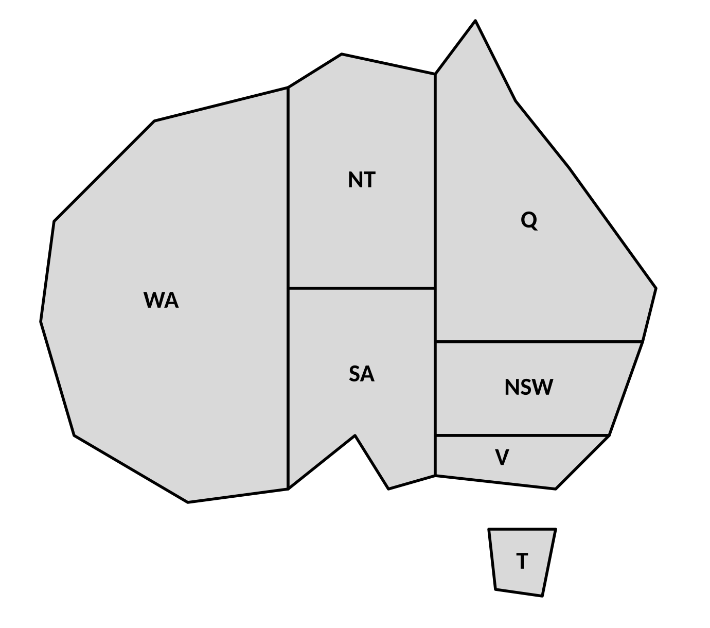

> 1) **Променливи:** WA, NT, SA, Q, NSW, V, T
> 2) **Домейни:** $D_i = \lbrace red, green, blue \rbrace$
> 3) **Ограничения:** $X \neq Y$, ако X и Y са съседни

**Крайна цел:** пълно присвояване (всеки регион има цвят), без нарушени ограничения.

 

## Защо изучаваме CSP като отделна тема?

### 1) Комбинаторен взрив
Нека имаме задача с $n$ променливи, всяка от които може да приеме $d$ различни стойности ( *размер на домейна* ). Ако използваме **brute force** и генерираме всички възможни комбинации, общият брой състояния е:

$$d^n$$

Например за Австралия това са $3^7 = 2187$ комбинации, но при 100 променливи с по 10 стойности са $10^{100}$ - изчерпателното търсене става физически невъзможно.

### 2) NP-пълни задачи
Повечето интересни CSP задачи са **NP-пълни**. Това означава, че няма известен полиномиален алгоритъм $O(n^k)$, който да ги решава в общия случай за разумно време. Колкото повече променливи и ограничения добавяме, толкова времето за намиране на решение нараства **експоненциално**.

### 3) Фокусът: съвместимост, а не оптимизация

#### ❕**ВАЖНО**❕
> Това е ключовата разлика между CSP и другите задачи (напр. търсене на най-къс път): при CSP **не търсим най-доброто решение** и не ни интересува дължината на пътя. Целта ни е просто да разберем дали **изобщо съществува** валидно решение. Намерим ли едно-единствено пълно присвояване, което спазва всички ограничения, задачата е решена.

### Ползата от CSP
Вместо да пишем специализиран алгоритъм за всяка отделна задача (Судоку, разписание в университета и т.н.), ние **дефинираме проблема декларативно** чрез *Променливи*, *Домейни* и *Ограничения*. Това ни позволява да използваме **общи интелигентни техники** за решаване, които работят за всяка CSP задача.

 

## Видове ограничения
Класифицираме ги основно по това **колко променливи засягат едновременно**.

### Унарни ограничения (Unary constraints)
Засягат **една** променлива.
- **Пример:** $X \neq green$
- **Обработка:** лесно - просто филтрираме домейна на променливата още в началото (от $D_X$ премахваме green)

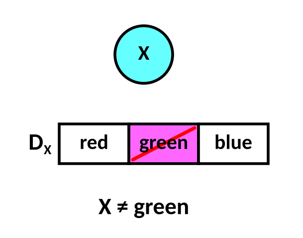

### Бинарни ограничения (Binary constraints)
Засягат **две** променливи.
- **Пример:** $X \neq Y$
- **Обработка:** могат лесно да се изчертаят в граф на ограниченията ( *constraint graph* ), където върховете са променливите

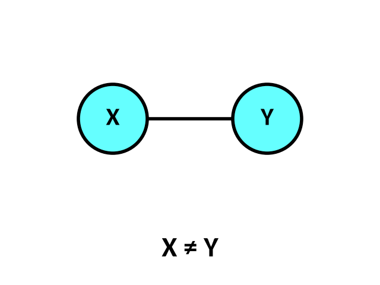

### Ограничения от по-висок ред (Higher-order constraints)
Засягат **3 или повече** променливи.
- **Пример:** при разписанието в университета - ограничение за капацитет на зала или натоварване на преподавател. За да проверим дали дадена зала не превишава капацитета си, трябва да съберем броя студенти от **всички** предмети $c_1, c_2, \dots, c_k$, насрочени в тази зала за даден час.

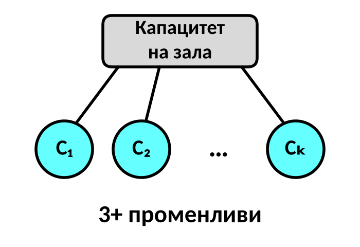

### Меки ограничения (Soft constraints)
Указват **предпочитания**, а не задължителни правила.
- **Пример:** преподавателят предпочита да има часове сутрин
- Тук нарушението води до **цена**, което превръща задачата в задача за оптимизация с ограничения ( *Constraint Optimization Problem - COP* )

| Вид | Брой променливи | Пример | Как се обработва |
| :--- | :--- | :--- | :--- |
| Унарни | 1 | $X \neq green$ | Филтрираме домейна в началото |
| Бинарни | 2 | $X \neq Y$ | Ребро в графа на ограниченията |
| От по-висок ред | 3+ | Капацитет на зала | Проверка върху всички засегнати променливи |
| Меки | - | Часове сутрин | Цена при нарушение → COP |

 

## Граф на ограниченията (Constraint Graph)
Начинът, по който визуализираме проблема:
- **Върхове (nodes)** - променливите
- **Ребра (edges)** - бинарните ограничения между тях

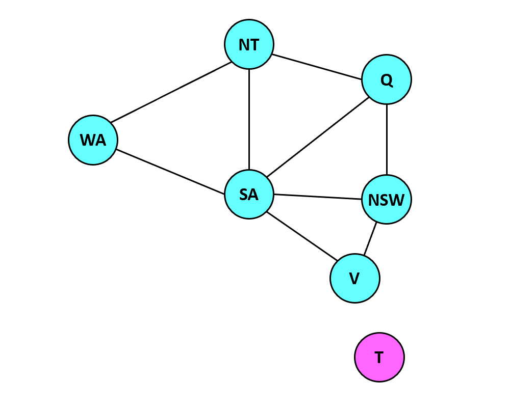

### Ползи:
- **Нагледност** - показва кои променливи си влияят директно
- **Раздели и владей (декомпозиция)** - ако графът има несвързани части, можем да решаваме всяка подзадача отделно, което драстично намалява изчисленията
- **Специална структура** - ако графът е дърво, задачата може да се реши бързо, в полиномиално време, без нужда от backtracking

#### ❕**ЗАБЕЛЕЖКА**❕
> В примера с Австралия: Тасмания (T) няма съседи - тя е отделна компонента на графа и може да се оцвети напълно независимо от останалите щати.

 

## Как решаваме CSP? Backtracking
Класическият начин за решаване на CSP е **backtracking** ( *търсене с връщане назад* ). Това е подобрена версия на обхождането в дълбочина (DFS).

> #### Алгоритъм:
> 1) Избираме променлива, на която още не сме присвоили стойност
> 2) Пробваме стойност от домейна ѝ
> 3) Ако стойността не нарушава ограниченията спрямо вече присвоените променливи - продължаваме със следващата променлива
> 4) Ако няма валидна стойност ( *задънена улица* ) - правим стъпка назад ( *backtrack* ) и променяме предходния избор
> 5) Спираме, когато всички променливи имат стойност

#### Пример: оцветяваме Австралия в реда WA, NSW, NT, Q, SA, ... (R = red, G = green, B = blue)
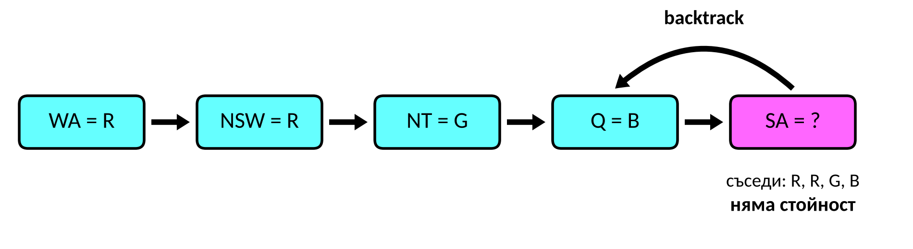

> SA е съседна на WA, NSW, NT и Q, които вече използват и трите цвята - за SA няма валидна стойност. Връщаме се назад и сменяме предходния избор.

### Двете основни правила на backtracking:
1) **Фиксираме подредбата на променливите** - променливите се оценяват една по една, защото присвояванията са комутативни:

$$X = red,\ Y = green \quad \equiv \quad Y = green,\ X = red$$

2) **Проверка за конфликт на всяка стъпка** - присвояваме стойност на дадена променлива само ако тя не нарушава ограниченията спрямо вече присвоените променливи. Ако стигнем до задънена улица (няма валидна стойност), правим стъпка назад ( *backtrack* ) и променяме предходния избор.

#### ❕**ВАЖНО**❕
> Заради първото правило на всяко ниво в дървото на търсене решаваме стойността само на **една** променлива. Иначе едно и също присвояване би се срещало многократно, само в различен ред.

 

## Как правим backtracking-а бърз?

### 1) MRV (Minimum Remaining Values)
**Коя променлива да изберем първа?**
- Избираме променливата с **най-малко останали валидни стойности** в домейна си
- **Логика:** това е най-ограничената (най-трудната) променлива. По-добре е да сгрешим рано в дървото за търсене, отколкото след 10 стъпки.

#### Пример: след WA = R и NT = G
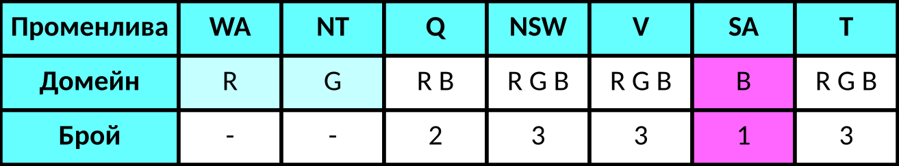

> SA има само 1 възможна стойност (B) - MRV избира SA.

### 2) LCV (Least Constraining Value)
**Коя стойност да пробваме първо?**
- За избраната променлива пробваме първо тази стойност, която **изключва най-малко възможности** от домейните на останалите неприсвоени променливи

#### Пример: след WA = R и NT = G избираме стойност за Q
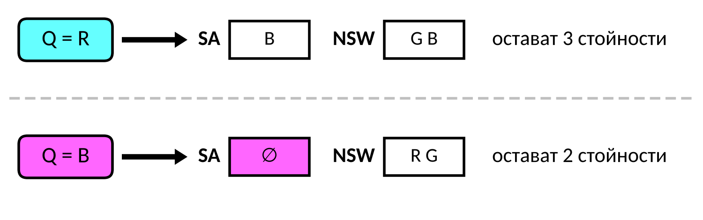

> Q = R оставя повече възможности на съседите (а при Q = B домейнът на SA остава празен) - LCV пробва първо R.

#### ❕**ЗАБЕЛЕЖКА**❕
> MRV и LCV си противоречат само на пръв поглед: при **променливата** искаме да се провалим рано (fail-first), а при **стойността** - да оставим най-много шанс за успех (fail-last).

### 3) Разпространение на ограниченията (Constraint Propagation)

#### Forward checking
При избор на стойност **веднага премахваме несъвместимите стойности** от домейните на нейните съседи. Ако някой домейн остане празен - **веднага връщаме назад**, без да чакаме да стигнем до тази променлива.

#### Пример:
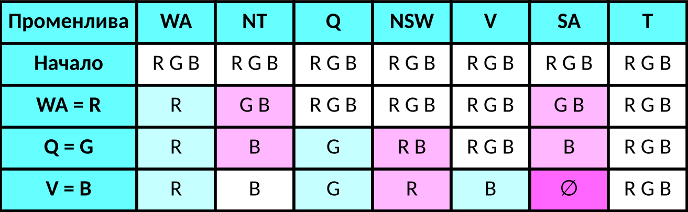

> След V = B домейнът на SA остава празен (∅) - връщаме се назад веднага, без да пробваме да оцветим SA.

#### AC-3 (Arc Consistency)
Алгоритъм, който поддържа **съгласуваност на дъгите** в графа, премахвайки предварително неизползваеми стойности.

Дъгата $X \rightarrow Y$ е **съгласувана**, ако за **всяка** стойност $x \in D_X$ съществува поне една стойност $y \in D_Y$, която не нарушава ограничението между тях.

> #### Алгоритъм:
> 1) Слагаме всички дъги от графа в опашка
> 2) Вадим дъга $X \rightarrow Y$ и премахваме от $D_X$ стойностите, за които няма подходяща стойност в $D_Y$
> 3) Ако $D_X$ се е променил - добавяме обратно в опашката всички дъги $Z \rightarrow X$ от съседите $Z$ на $X$
> 4) Ако някой домейн остане празен - задачата няма решение
> 5) Повтаряме, докато опашката се изпразни

#### Пример: след WA = R и Q = G домейните са NT = {B} и SA = {B}
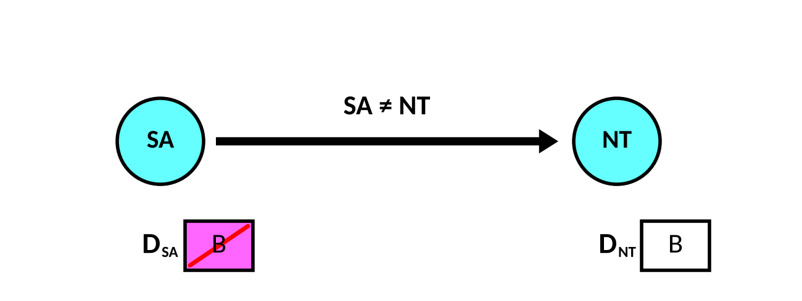

> За SA = B няма стойност на NT, която да е различна от B → премахваме B от домейна на SA → домейнът на SA остава празен (∅).

#### ❕**ВАЖНО**❕
> Forward checking **не забелязва** този проблем - нито един домейн още не е празен. AC-3 го открива веднага, защото проверява и връзките между **неприсвоени** променливи.

| Техника | Въпрос | Идея |
| :--- | :--- | :--- |
| MRV | Коя променлива? | Най-малко останали стойности |
| LCV | Коя стойност? | Изключва най-малко възможности за съседите |
| Forward checking | Кога да спрем? | Премахваме несъвместимите стойности от съседите веднага |
| AC-3 | Кога да спрем? | Поддържаме всички дъги съгласувани |

 

## Пример: N царици (N-Queens)
Трябва да разположим **N царици** на шахматна дъска **N × N** така, че никои 2 да не се засичат (застрашават) - по **ред, колона** и **диагонал**.

Това е класическа CSP задача.

### Умно моделиране
**Фиксираме колоните** - приемаме, че във всяка колона има точно 1 царица:
- **Променливите** са самите колони: $Q_0, Q_1, \dots, Q_{N-1}$
- **Домейнът** на всяка променлива са редовете, на които може да се намира царицата: $D_i = \lbrace 0, 1, \dots, N-1 \rbrace$

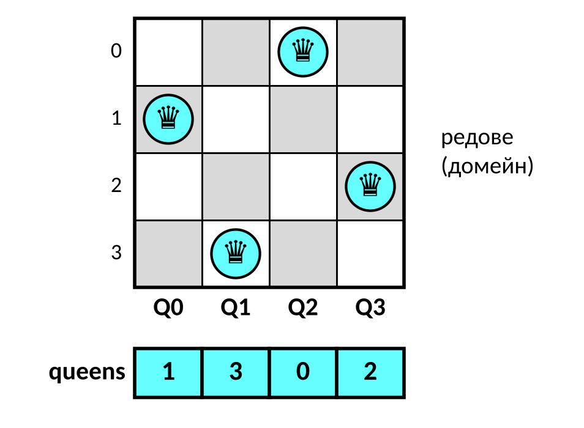

#### ❕**ВАЖНО**❕
> Това моделиране **автоматично елиминира конфликтите по колони** - остава да следим само редовете и диагоналите.

### Масиви за конфликти
Пазим 4 масива, за да проверяваме конфликтите за $O(1)$:
- **queens** - редът на царицата в своята колона
- **брой царици на всеки ред**
- **брой царици на всеки диагонал ↘** - клетките с еднаква стойност на $row - col$ (индекс $row - col + N - 1$)
- **брой царици на всеки диагонал ↙** - клетките с еднаква стойност на $row + col$

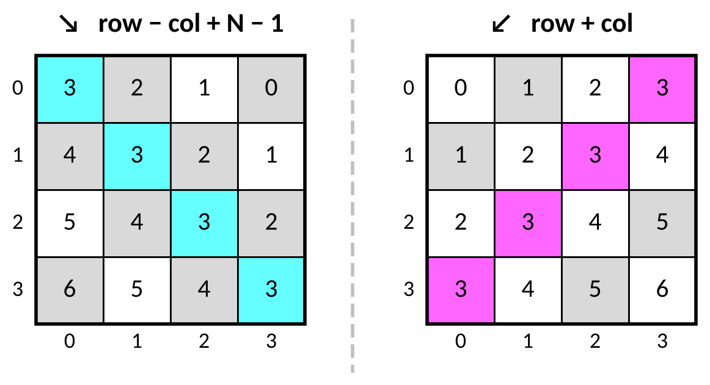

### Алгоритъм Min-Conflicts
> 1) Нареждаме царици произволно (по 1 във всяка колона)
> 2) Докато има конфликти ($h > 0$):
>      - избираме случайна конфликтна царица
>      - местим я в рамките на нейната колона на реда с **минимален брой конфликти**
>      - обновяваме масивите
> 3) Когато $h = 0$ - намерили сме решение

#### Пример с 4 царици:
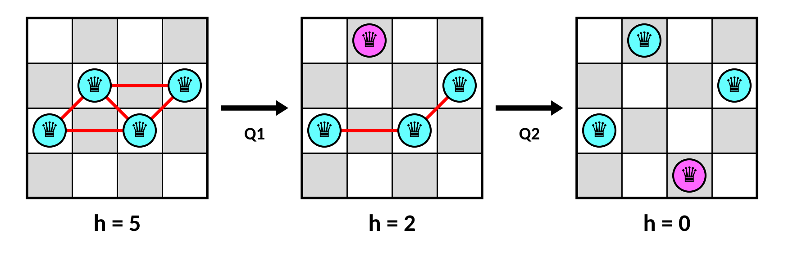

> Червените линии са двойките царици, които се застрашават. Местим Q1 → $h = 2$, после местим Q2 → $h = 0$ - решение.

#### ❕**ЗАБЕЛЕЖКА**❕
> Min-Conflicts **не е** backtracking, а локално търсене - работи върху **пълно** (но невалидно) присвояване и постепенно го поправя. Ако алгоритъмът се забави (не намалява $h$ дълго време), започваме отначало с ново случайно подреждане.
