# Упражнение 4: Генетични алгоритми

## Генетичен алгоритъм (Genetic Algorithm)
Генетичният алгоритъм е техника за **търсене и оптимизация**, вдъхновена от естествената еволюция. Вместо да разширяваме *едно* текущо състояние (както например при BFS и A*), държим **много решения едновременно** и ги „развиваме“ с три принципа - **селекция, crossover и мутация**, докато стигнем до достатъчно добро решение.

Използваме го, когато пространството от решения е твърде голямо, за да го обходим цялото. Например при 50 града има $50! \approx 3 \times 10^{64}$ възможни маршрута.

### Основни понятия:
- **Ген (Gene)** - един параметър, част от решението
- **Хромозома (Chromosome)** - всички гени заедно = **едно** пълно решение. Наричаме я още индивид ( *individual* )
- **Популация (Population)** - множество хромозоми = много решения, които тестваме едновременно
- **Фитнес (Fitness)** - число, което показва колко добро е дадено решение: **по-голям fitness = по-добро решение**

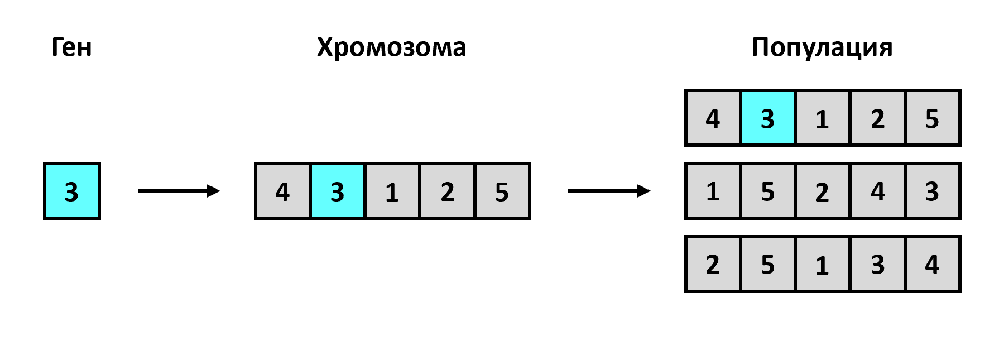

### Кодиране на решението (Encoding):
Първата стъпка винаги е да решим как изглежда една хромозома.

| Кодиране | Примерна задача | Хромозома | Значение |
| :--- | :--- | :--- | :--- |
| Двоично ( *binary coded* ) | *Knapsack* | 1 0 1 1 0 | Взимаме предмети 1, 3 и 4 |
| Пермутация ( *order coded* ) | *TSP* | 3 1 4 2 5 | Обикаляме градовете в този ред |

#### ❕**ВАЖНО**❕
> При пермутация всяка стойност се среща **точно веднъж**. Ако в една хромозома дадена стойност се появи два или повече пъти, това вече не е валидно решение.

</br>

## Цикъл на генетичния алгоритъм

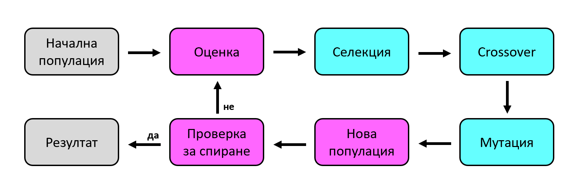

Едно завъртане на цикъла = едно **поколение** ( *generation* ). Повтаряме, докато популацията спре да се подобрява.

> #### Алгоритъм:
> 1) Създаваме **начална популация** - обикновено от случайни хромозоми
> 2) **Оценяваме** всяка хромозома с fitness функцията
> 3) **Селекция** - избираме родители, като по-добрите имат по-голям шанс да бъдат избрани
> 4) **Crossover** - от двама родители създаваме деца
> 5) **Мутация** - с малка вероятност променяме децата случайно
> 6) Децата стават **новата популация**
> 7) **Проверка за спиране** - намерихме ли решение / изчерпахме ли поколенията / има ли подобрение? 
>      - Ако не сме приключили - връщаме се на **стъпка 2)**
>      - Ако сме приключили - връщаме **резултата**

#### ❕**ВАЖНО**❕
> Генетичният алгоритъм **не гарантира** оптимално решение (за разлика от A* с допустима евристика). Той е локално търсене с много точки едновременно.

</br>

## Селекция (Selection)
Селекцията е етапът, в който избираме кои хромозоми ще станат родители.

Всички примери по-долу използват една и съща популация:

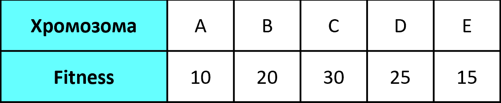

```python
import numpy as np

population = ['A', 'B', 'C', 'D', 'E']
fitness_scores = [10, 20, 30, 25, 15] # higher is better
```

### Selection pressure
Колко силно алгоритъмът предпочита най-добрите индивиди при избора на родители.

| | Висок натиск | Нисък натиск |
| :--- | :--- | :--- |
| Кой става родител | Почти само най-добрите | По-случаен избор |
| Сходимост | Бърза | Бавна |
| Разнообразие ( *diversity* ) | Изчезва | Запазва се |
| Риск | Преждевременно схождане - засядаме в локален оптимум | Търсенето е бавно, почти случайно |

### Рулетка (Roulette Wheel Selection)
Всяка хромозома се избира с вероятност, **пропорционална на нейния fitness**:

$$p(i) = \frac{\text{fitness}(i)}{\sum_{j=1}^{N} \text{fitness}(j)}$$

където $N$ е броят на хромозомите в популацията.

> #### Алгоритъм:
> 1) Смятаме сумата на fitness-ите: $10 + 20 + 30 + 25 + 15 = 100$
> 2) Смятаме вероятностите: A = 0.10, B = 0.20, C = 0.30, D = 0.25, E = 0.15
> 3) Нареждаме ги една след друга върху отсечката [0, 100): A = [0, 10), B = [10, 30), C = [30, 60), D = [60, 85), E = [85, 100)
> 4) Генерираме случайно число r и взимаме хромозомата, в чийто интервал попада. Повтаряме толкова пъти, колкото родители ни трябват

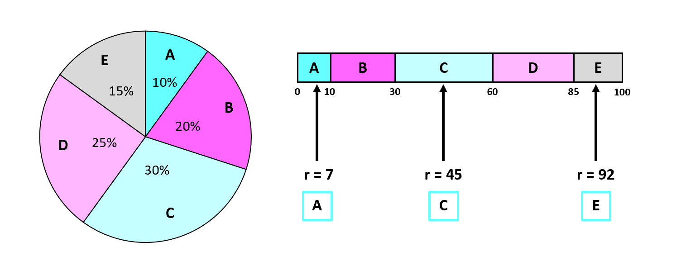

#### ❕**ЗАБЕЛЕЖКА**❕
> Една добра хромозома трябва да може да бъде родител няколко пъти.

#### ❕**ВАЖНО**❕
> Рулетката работи само с **неотрицателен** fitness, при който по-голямо = по-добро. Ако минимизираме (дължина на маршрут, брой конфликти), първо обръщаме стойността, напр. $\text{fitness} = \frac{1}{\text{дължина}}$.

| Плюсове | Минуси |
| :--- | :--- |
| Проста за реализация | Ако една хромозома е много по-добра от останалите, тя „завзема“ рулетката → преждевременно схождане |
| Работи добре при умерени разлики във fitness-a | Чувствителна е към мащаба на fitness-а |

### Stochastic Universal Sampling (SUS)
Вариант на рулетката: вместо k отделни завъртания, поставяме **k стрелки на равно разстояние** и завъртаме **веднъж**.

> #### Алгоритъм (за k = 4 родители):
> 1) Разстояние между стрелките $= \frac{\text{сума}}{k} = \frac{100}{4} = 25$
> 2) Избираме случайно начало в [0, 25), напр. 8
> 3) Стрелките са в 8, 33, 58, 83 → избрани са **A, C, C, D**

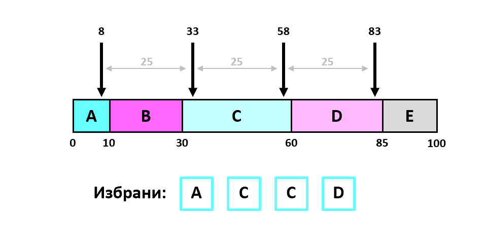

#### ❕**ЗАБЕЛЕЖКА**❕
> C заема 30 от 100, а стрелките са през 25 - затова C е **гарантирано** избрана поне веднъж. При обикновената рулетка може да ни се падне 4 пъти A.

| Плюсове | Минуси |
| :--- | :--- |
| По-малко случайност (по-малка дисперсия) | Малко по-сложна за реализация |

### Турнирна селекция (Tournament Selection)
Избираме случайно **k** хромозоми ( *турнир* ) и най-добрата от тях става родител. Повтаряме за всеки родител.

#### Пример с k = 3:
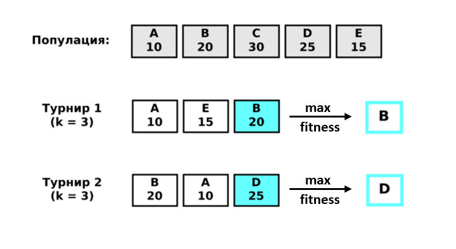

- **По-голямо k** → по-силен натиск. При k = 5 (цялата популация) винаги печели C
- **По-малко k** → повече разнообразие. При k = 1 изборът е напълно случаен

#### ❕**ВАЖНО**❕
> Най-слабите $k - 1$ хромозоми **никога** не стават родители. Например при k = 3 хромозомата A не може да спечели турнир.

| Плюсове | Минуси |
| :--- | :--- |
| Не зависи от мащаба на fitness-а - само сравняваме | При голямо k губим разнообразие |

### Селекция по ранг (Rank-Based Selection)
Не гледаме самия fitness, а **мястото в класирането**.

> #### Алгоритъм:
> 1) Сортираме по fitness във възходящ ред: A, E, B, D, C
> 2) Даваме рангове 1, 2, 3, 4, 5 (най-добрият получава най-големия ранг)
> 3) Вероятност $p(i) = \frac{\text{rank}(i)}{1 + 2 + 3 + 4 + 5} = \frac{\text{rank}(i)}{15}$ → A = 0.07, E = 0.13, B = 0.20, D = 0.27, C = 0.33
> 4) Избираме както при рулетка, но с тези вероятности

#### Пример: какво става, ако C има fitness 300 вместо 30?
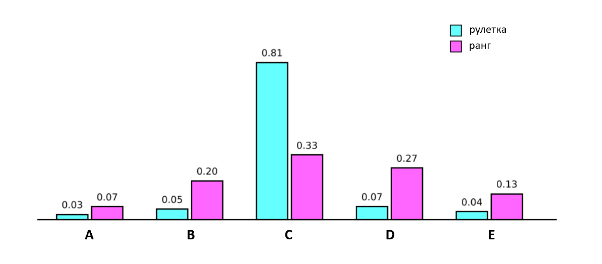

> При рулетката C скача на $\frac{300}{370} \approx 0.81$ - почти всички деца ще са нейни. При ранга C си остава първа и има пак 0.33. Рангът гледа **кой е по-добър**, а не **с колко**.


| Плюсове | Минуси |
| :--- | :--- |
| Една много добра хромозома не може да доминира | По-бавно схождане, защото изглажда разликите |
| Стабилен селекционен натиск | Нужно е сортиране - $O(n \log n)$ |

### Елитизъм (Elitism) и Отрязване (Truncation)
- **Елитизъм** - най-добрите няколко хромозоми минават в следващото поколение **без промяна**. Гарантира, че най-доброто решение никога не се влошава. Използва се *заедно* с друг метод за селекция.
- **Отрязване** - сортираме, пазим само горните 20–50% и избираме родители равновероятно само от тях. При горни 40% от A–E остават само C и D.

#### ❕**ВАЖНО**❕
> Елитизмът не е начин за избиране на родители, а начин да *пазим* най-добрите. Ако елитът е твърде голям и натискът е силен, популацията бързо става еднаква.

### Сравнение на методите за селекция:
| Метод | Идея | Сила | Слабост |
| :--- | :--- | :--- | :--- |
| Рулетка | Вероятност, пропорционална на fitness-а | Проста | Преждевременно схождане |
| SUS | Рулетка с k равноотдалечени стрелки | Малко късмет | По-сложна |
| Турнир | Най-добрият от k случайни | Настройваем натиск | Губи разнообразие при голямо k |
| Ранг | Вероятност по мястото в класирането | Стабилен натиск | По-бавно схождане |
| Елитизъм | Най-добрите оцеляват непроменени | Гарантира прогрес | По-малко разнообразие |
| Отрязване | Само горните X% | Просто, силен натиск | Бърза загуба на разнообразие |

</br>

## Crossover
От двама (или повече) родители създаваме деца, които носят части от всеки родител. Идеята е, че ако и двамата родители са добри, комбинация от добрите им части може да е още по-добра.

### One-point crossover
Избираме една точка на рязане и разменяме опашките на родителите.

При **двоично кодиране** това винаги работи - всяка комбинация от 0 и 1 е валидна. При **пермутация** обаче простото разменяне чупи решението:

#### Пример:

> Родител 1 = **1 2 3** | 4 5 \
> Родител 2 = **5 4 3** | 2 1 \
> Дете = 1 2 3 | 2 1 → гените 1 и 2 се срещат два пъти, а 4 и 5 липсват!

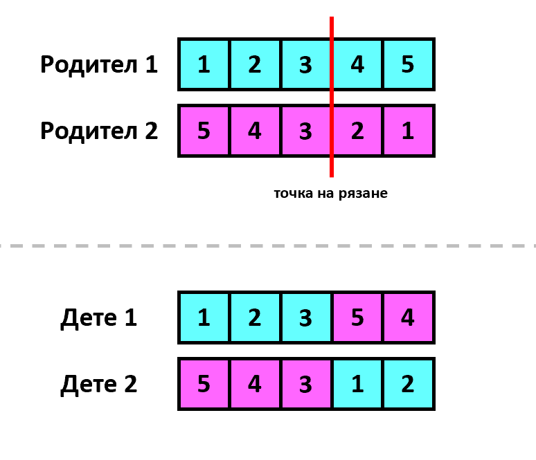

> #### Алгоритъм (за пермутации):
> 1) Копираме първата част от родител 1: 1 2 3
> 2) Обхождаме родител 2 отляво надясно и дописваме само тези гени, които ги няма: 5, 4
> 3) Дете 1 = **1 2 3 5 4**. Аналогично Дете 2 = **5 4 3 1 2**


#### ❕**ВАЖНО**❕
> Crossover за пермутации трябва винаги да връща **пермутация**. Всеки метод по-долу е начин да се гарантира това.

### Two-point crossover
Избираме **две** точки и взимаме средния сегмент от родител 1.

#### Пример:

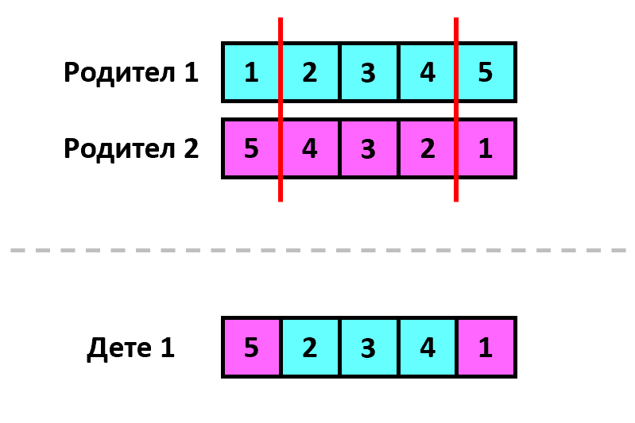

> #### Алгоритъм:
> 1) Копираме сегмента от p1 на същите позиции: _ 2 3 4 _
> 2) Четем p2, **започвайки след втората точка** и превъртайки в началото: 1, 2, 3, 4, 5. Прескачаме вече взетите → остават 1, 5
> 3) Попълваме празните места също след втората точка и превъртайки: позиция 4 ← 1, позиция 0 ← 5
> 4) Дете = **5 2 3 4 1**


### Uniform crossover
За **всеки** ген случайно решаваме от кой родител да го вземем. Решението се пази в маска: 1 = от родител 1, 0 = от родител 2. Дете 2 взима обратното.

#### Пример:

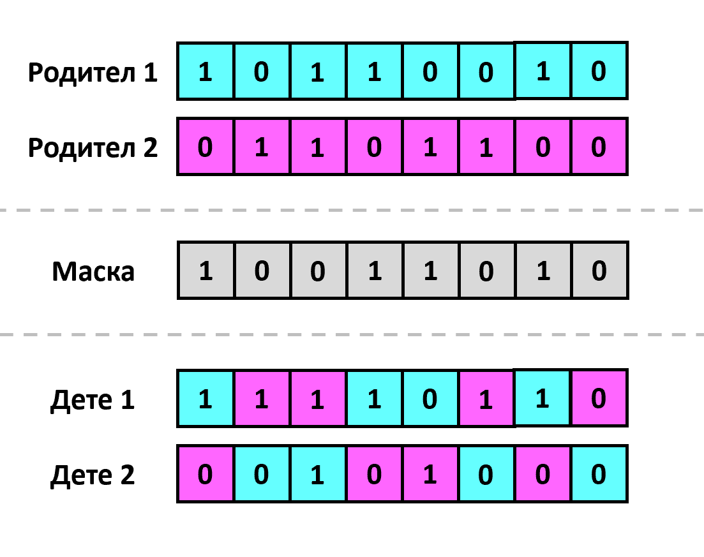

#### ❕**ЗАБЕЛЕЖКА**❕
> Равномерният crossover не работи директно за пермутации - отново може да се повтори стойност. Затова за пермутации използваме PMX и Cycle crossover.

### PMX (Partially-Mapped Crossover)

#### Пример:
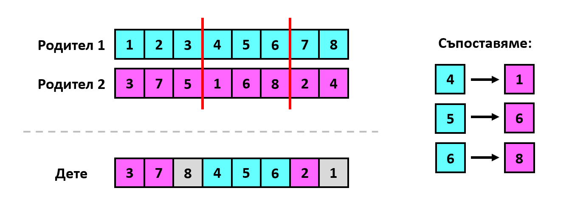

> #### Алгоритъм:
> 1) Копираме сегмента от p1: _ _ _ 4 5 6 _ _
> 2) Записваме съпоставянето по позициите в сегмента: **4 → 1, 5 → 6, 6 → 8**
> 3) Останалите позиции взимаме от p2. Ако генът вече е в сегмента, следваме съпоставянето, докато излезем от него:
>       - позиция 0: 3 → свободен → **3**
>       - позиция 1: 7 → свободен → **7**
>       - позиция 2: 5 → зает! 5 → 6 → зает! 6 → 8 → свободен → **8**
>       - позиция 6: 2 → свободен → **2**
>       - позиция 7: 4 → зает! 4 → 1 → свободен → **1**
> 4) Дете = **3 7 8 4 5 6 2 1**


### Cycle crossover
Всеки ген остава **на същата позиция**, на която е бил в някой от родителите.

#### Пример:
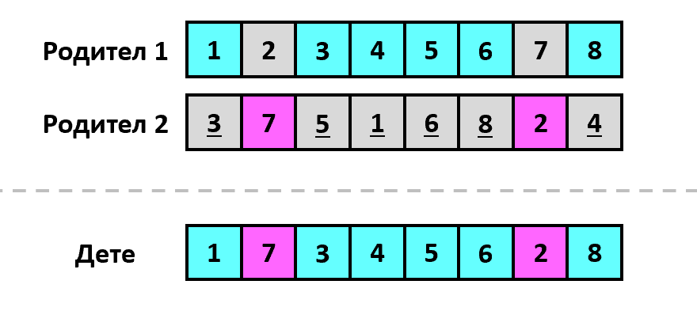

> #### Алгоритъм:
> 1) Започваме от позиция 0: в p1 има 1. Под него в p2 е 3 → търсим 3 в p1 (позиция 2) → под него 5 → позиция 4 → 6 → позиция 5 → 8 → позиция 7 → 4 → позиция 3 → 1 → върнахме се в началото
> 2) Цикъл 1 = позиции {0, 2, 3, 4, 5, 7} → взимаме ги **от p1**
> 3) Първата непосетена позиция е 1 → цикъл 2 = позиции {1, 6} → взимаме ги **от p2**
> 4) Нечетните цикли са от p1, четните - от p2. Дете = **1 7 3 4 5 6 2 8**


</br>

## Мутация (Mutation)
Малка случайна промяна в **една** хромозома. Случва се с малка вероятност ( *mutation rate* ) и пази разнообразието в популацията.

| Оператор | Какво прави | Резултат |
| :--- | :--- | :--- |
| swap | Разменя два гена | 2 **4** 5 **1** 3 |
| insertion | Изважда един ген и го вмъква на друго място | 2 5 4 **1** 3 |
| reverse | Обръща целия сегмент между двете позиции | 2 **4 5 1** 3 |

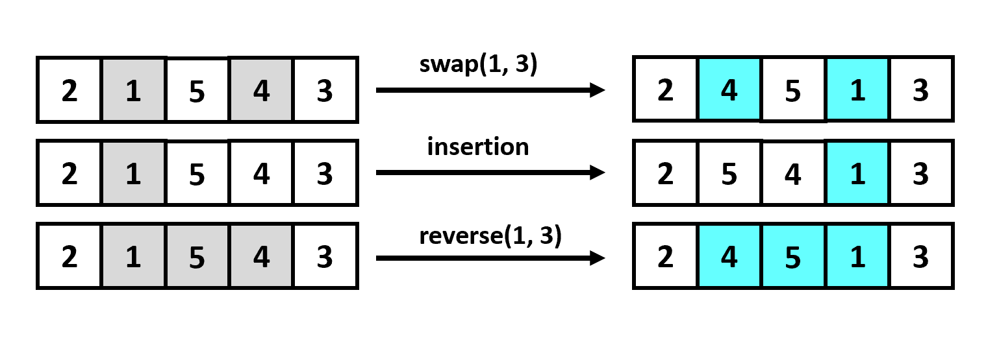

#### ❕**ЗАБЕЛЕЖКА**❕
> При 60 деца и mutation rate 0.3 очакваме средно $60 \times 0.3 = 18$ мутации, но **не точно** 18 във всяко поколение - за всяко дете се „хвърля монета“ отделно.

#### ❕**ВАЖНО**❕
> Без мутация популацията може само да пренарежда вече съществуващи парчета. Crossover-ът **комбинира**, мутацията **изобретява**. Твърде висока мутация пък превръща алгоритъма в случайно търсене.