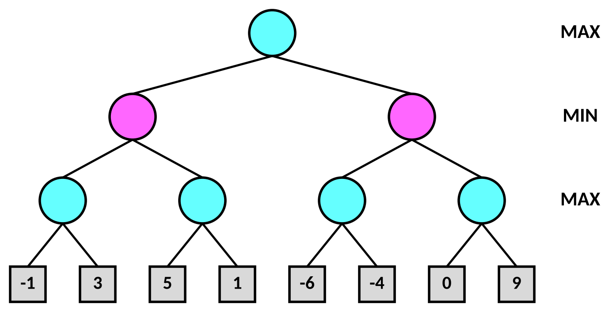
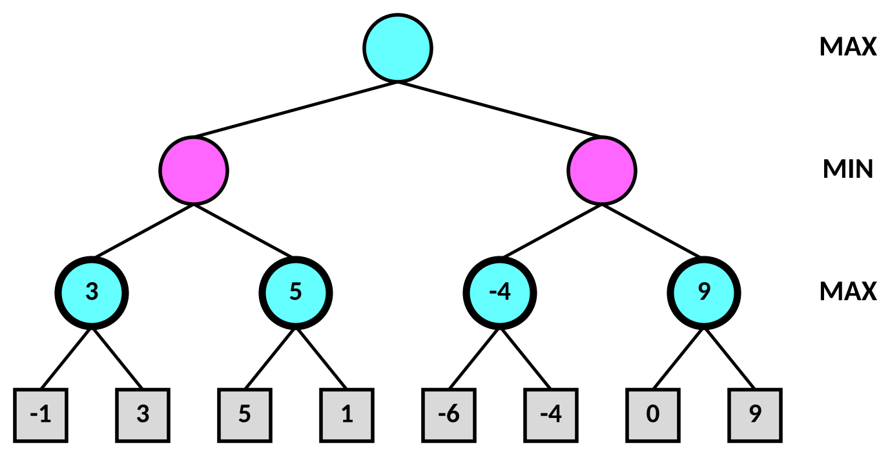
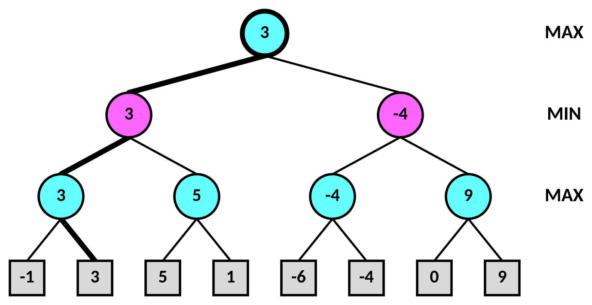
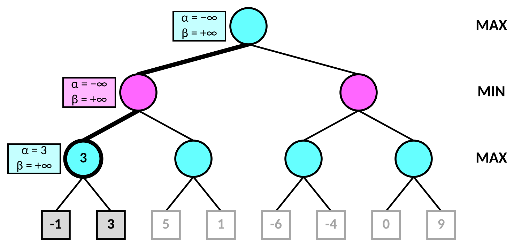
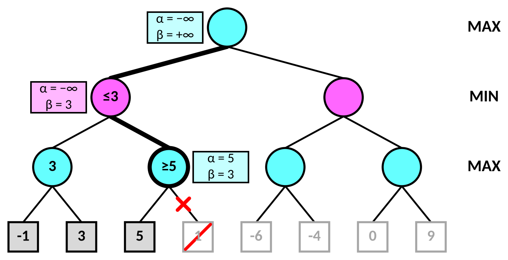
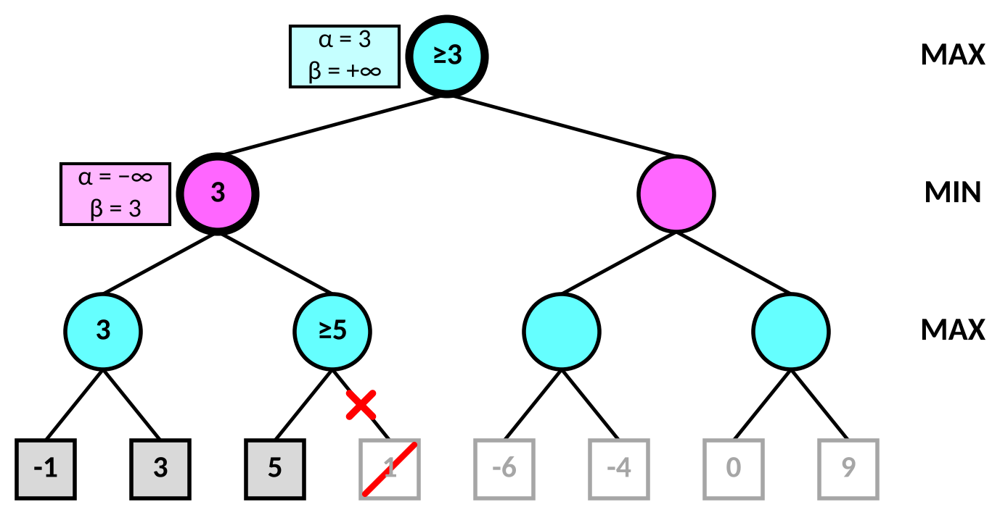
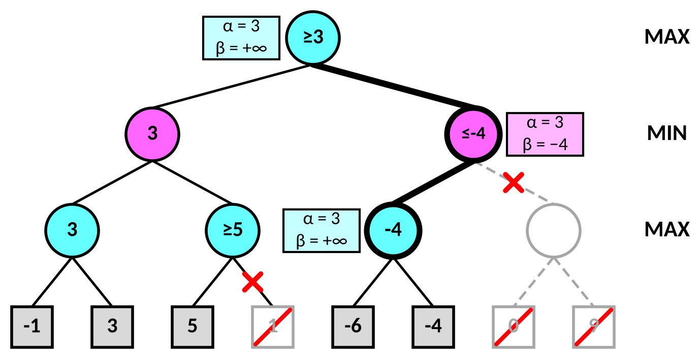
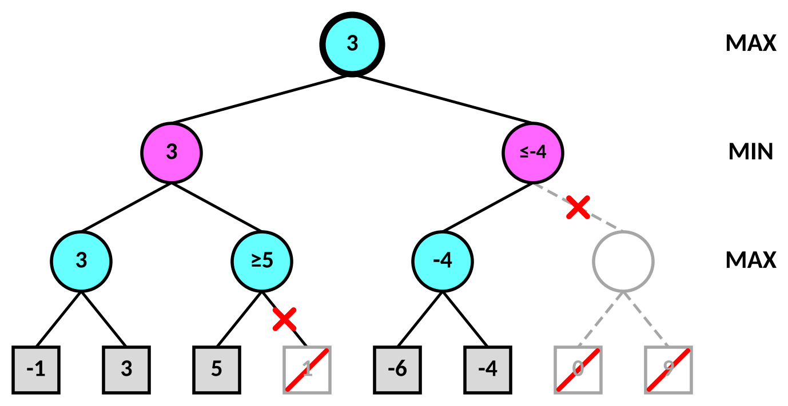
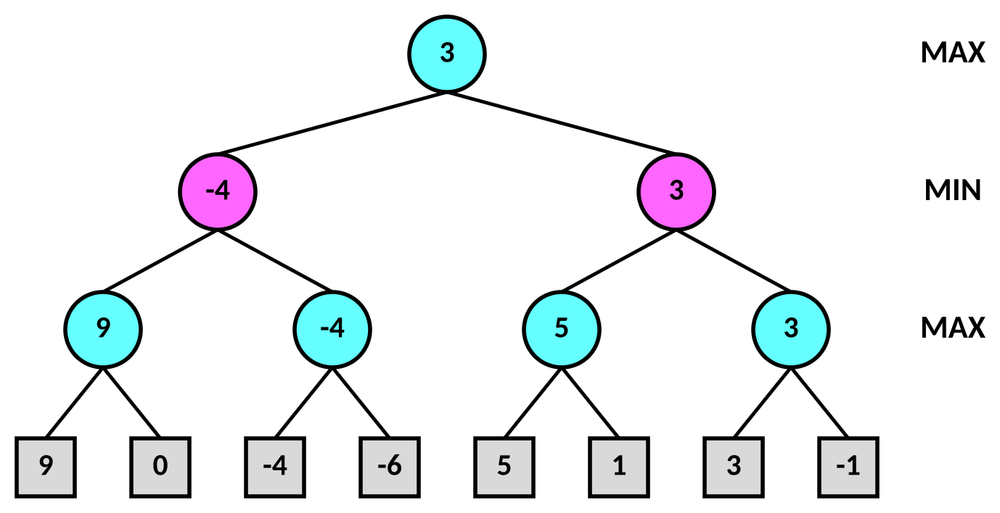
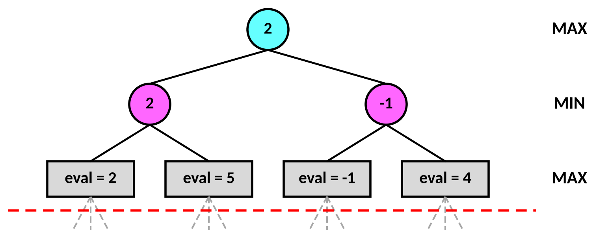

# Упражнение 5: Състезателно търсене и игри

## Състезателно търсене (Adversarial Search)
При игрите имаме **противник**, който иска точно обратното на нас. Това се нарича състезателно търсене ( *adversarial search* )

### Видове игри:
- **Пълна информация (Perfect information)** - всеки играч знае **всички досегашни ходове**. Няма скрита история.
- **Пълно знание (Complete information)** - всеки играч знае **правилата и какво печели или губи всеки друг**. Няма скрити цели.
- **Детерминирана (Deterministic)** - няма зарове, теглене на карти и др. Играта няма **елемент на случайност** ( *chance* ).

| | Детерминирана | Случайност |
| :--- | :--- | :--- |
| **Perfect information** | шах | монополи |
| **Complete information** | морски бой | покер |

#### ❕**ЗАБЕЛЕЖКА**❕
> Perfect information **не означава** complete information. Пример с пазарене: играч 1 предлага цена, играч 2 приема или отказва. Всички ходове са видими (perfect), но играч 1 не знае минималната цена, която играч 2 би приел (не е complete).

В рамките на упражнението ще говорим за игри с **двама играчи**, **пълна информация**, **без случайност** и с **нулева сума** ( *zero-sum* ) - моята печалба е твоята загуба. Например шах, табла без зарове, морски шах.

 

## Дърво на играта (Game Tree)
Дървото на играта представлява ориентиран граф, в който:
- **Върховете** са състояния на играта (напр. наредба на дъската)
- **Ребрата** са ходове от едно състояние в друго
- **Нивата се редуват**: на едното играе **MAX** (иска голям резултат), на следващото - **MIN** (иска малък резултат)
- **Листата** са крайни състояния с резултат (например за морски шах: X печели → $+1$, O печели → $-1$, реми → $0$).

> Всички примери по-долу използват това дърво с листа $-1$, $3$, $5$, $1$, $-6$, $-4$, $0$, $9$.

 

## Minimax
**Minimax** избира хода, който **минимизира максималната възможна загуба**, като приема, че противникът винаги играе оптимално:
- **MAX** взима **максимума** на децата си
- **MIN** взима **минимума** на децата си

> #### Алгоритъм:
> 1) Ако върхът е краен (играта е свършила) - връщаме оценката му
> 2) Ако на ход е MAX - смятаме minimax за всеки наследник и връщаме **най-голямата** стойност
> 3) Ако на ход е MIN - смятаме minimax за всеки наследник и връщаме **най-малката** стойност
> 4) В корена избираме хода, който води до тази стойност

#### ❕**ЗАБЕЛЕЖКА**❕
> Това е обхождане в дълбочина (DFS). Разликата е, че при връщането нагоре всеки връх носи число и решава дали да вземе max или min - според това чий е ходът.

### Пример стъпка по стъпка

#### Стъпка 1: долното ниво MAX взима максимума на листата си

> $\max(-1, 3) = 3$ \
> $\max(5, 1) = 5$ \
> $\max(-6, -4) = -4$ \
> $\max(0, 9) = 9$

#### Стъпка 2: нивото MIN взима минимума

> $\min(3, 5) = 3$ \
> $\min(-4, 9) = -4$

#### Стъпка 3: коренът (MAX) взима максимума

> $\max(3, -4) = 3$ \
> Удебеленият път е партията при оптимална игра на двамата играчи.

#### ❕**ВАЖНО**❕
> В дясната част има листо $9$ - най-голямото число в дървото. MAX не отива натам, защото MIN няма да го пусне до $9$ - ще избере $-4$. Minimax не гони най-добрия случай, а се пази от най-лошия.

#### ❕**ВАЖНО**❕
> Стойностите се смятат **отдолу нагоре**, ниво по ниво. Първо проверете кое ниво е MAX и кое е MIN - ако ги размените, целият отговор е грешен.

### Свойства на minimax:
| Свойство | Отговор |
| :--- | :--- |
| Пълен ( *complete* ) | Да, ако дървото е крайно |
| Оптимален | Да, срещу оптимален противник |
| Време | $O(b^m)$ |
| Памет | $O(b \cdot m)$ - като DFS |

Където $b$ е броят възможни ходове от всяко състояние, а $m$ е максималната дълбочина.

### Кога minimax е оптимален?
| Условие | Ако не е изпълнено |
| :--- | :--- |
| Двама играчи | Структурата max/min се разпада |
| Нулева сума ( *zero-sum* ) | Целите на MAX и MIN вече не са противоположни |
| Perfect information | Скрита информация (покер) - трябват други методи |
| Детерминирана игра | Зарове → **Expectimax**: между MAX и MIN има върхове „случайност“, които смятат очаквана стойност |
| Търсим до края на играта | Спираме на дълбочина и резултатът е само толкова добър, колкото е евристиката |

#### ❕**ЗАБЕЛЕЖКА**❕
> Ако знаем, че противникът е слаб, minimax не е задължително най-добрата стратегия. Той няма да загуби, но няма и да заложи капан, защото приема, че противникът ще го забележи.

 

## Alpha-beta отсичане (Alpha-beta pruning)
Alpha-beta отсичането дава **същия отговор** като minimax, но **пропуска обхождането на поддървета**, които няма как да променят резултата.

### α и β:
- **α (alpha)** - най-добрата стойност, която **MAX вече си е гарантирал** на това ниво или по-горе. Започва от $-\infty$ и само расте.
- **β (beta)** - най-добрата стойност, която **MIN вече си е гарантирал**. Започва от $+\infty$ и само намалява.
- **Отсичаме, когато** $\beta \le \alpha$ ( *условие за отсичане* ) - единият играч вече има по-добра алтернатива по-рано в дървото и няма да пусне играта до тук.

#### ❕**ЗАБЕЛЕЖКА**❕
> Мислете за α и β като за две стени, които се приближават. α е долната стена - „по-надолу от това MAX няма да слезе“. β е горната - „по-нагоре от това MIN няма да пусне“. Когато стените се срещнат, в този клон няма място за отговор.

> #### Алгоритъм (разликата с minimax):
> 1) Коренът започва с $\alpha = -\infty$, $\beta = +\infty$. Всеки връх предава своите α и β **надолу** на децата си
> 2) MAX след всяко дете: $\alpha = \max(\alpha, \text{стойност})$
> 3) MIN след всяко дете: $\beta = \min(\beta, \text{стойност})$
> 4) Ако $\beta \le \alpha$ - спираме ( *break* ), останалите деца не се разглеждат

### Пример стъпка по стъпка (същото дърво)

#### Стъпка 1: слизаме наляво

> Тръгваме с $\alpha = -\infty$, $\beta = +\infty$. Най-левият MAX вижда $-1$, после $3$ → $\alpha = 3$ и стойността на върха става $3$.

#### Стъпка 2: първото отсичане

> Левият MIN получава $3$ → $\beta = 3$. Вторият MAX тръгва с $\alpha = -\infty$, $\beta = 3$. Вижда $5$ → $\alpha = 5$, при което $\beta \le \alpha$ → **отсичаме листото 1**. Този MAX ще е поне $5$, а MIN вече има $3$ - няма да го избере, каквото и да е последното листо.

#### Стъпка 3: обратно в корена

> Левият MIN е $\min(3, \ge 5) = 3$. Коренът получава $\alpha = 3$ - MAX вече си е гарантирал $3$.

#### Стъпка 4: отсичаме цял клон

> Десният MIN тръгва с $\alpha = 3$. Първият му MAX вижда $-6$ и $-4$ и избира по-голямата → $-4$. За MIN: $\beta = -4 \le \alpha = 3$ → **отсичаме целия последен клон (0 и 9)**. MIN вече може да свали резултата до $-4$, а MAX има $3$ вляво - няма да дойде тук, дори да се крие $9$.

#### Резултат

> Коренът отново е $3$, но оценихме само **5 от 8** листа → $1$, $0$ и $9$ са отсечени.

#### ❕**ВАЖНО**❕
> Alpha-beta **не променя отговора** - пести само работа. Ако получите различна стойност в корена от minimax, някъде има грешка.

#### ❕**ВАЖНО**❕
> Началното извикване е винаги с $\alpha = -\infty$, $\beta = +\infty$ и с играча, който е на ход в корена.

### Редът на ходовете има значение (Move ordering)
#### Пример: същите 8 листа в най-лошия ред

| Подредба на листата | Оценени листа | Корен |
| :--- | :---: | :---: |
| $-1, 3, 5, 1, -6, -4, 0, 9$ (най-добрият ред) | 5 / 8 | $3$ |
| $9, 0, -4, -6, 5, 1, 3, -1$ (най-лошият ред) | 8 / 8 | $3$ |

> Ако първо разгледаме най-добрия ход, стените α и β се стесняват рано и отсичаме много. Ако го разгледаме най-накрая, alpha-beta е точно като minimax. При идеален ред времето пада от $O(b^m)$ до около $O(b^{m/2})$ - същото време стига да търсим **двойно по-дълбоко**.

#### ❕**ЗАБЕЛЕЖКА**❕
> Не знаем кой ход е най-добрият, преди да сме го изчислили, но можем да предположим с евристика. Например в шах първо се пробват взиманията и шаховете.

 

## Ограничена дълбочина и оценяваща функция
За истински игри не можем да стигнем до края на дървото, дори с alpha-beta. Затова добавяме:
- **Тест за спиране ( *cutoff test* )** - напр. ограничение по дълбочина: спираме след $d$ хода, дори играта да не е свършила
- **Оценяваща функция ( *evaluation function* )** - евристика, която **предполага** колко добра е недоиграна позиция. Поставяме я вместо истинските стойности на листата

#### Пример: търсене до дълбочина 2

> Под червената граница не търсим. Позициите на дълбочина 2 се оценяват с $eval()$, а minimax работи над тях както преди: MIN получава $2$ и $-1$, коренът → $2$.

#### ❕**ВАЖНО**❕
> При ограничена дълбочина minimax вече не е гарантирано оптимален - той е толкова добър, колкото е оценяващата функция.